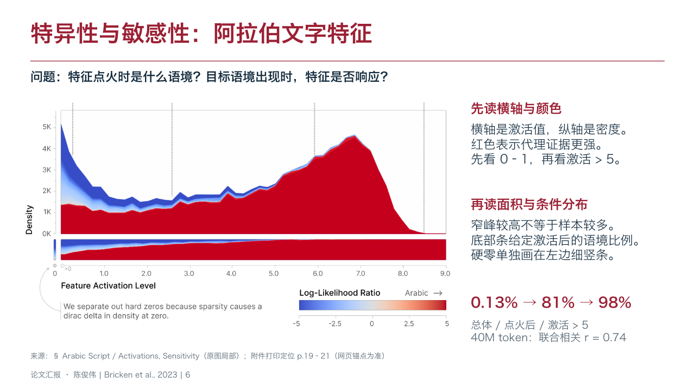
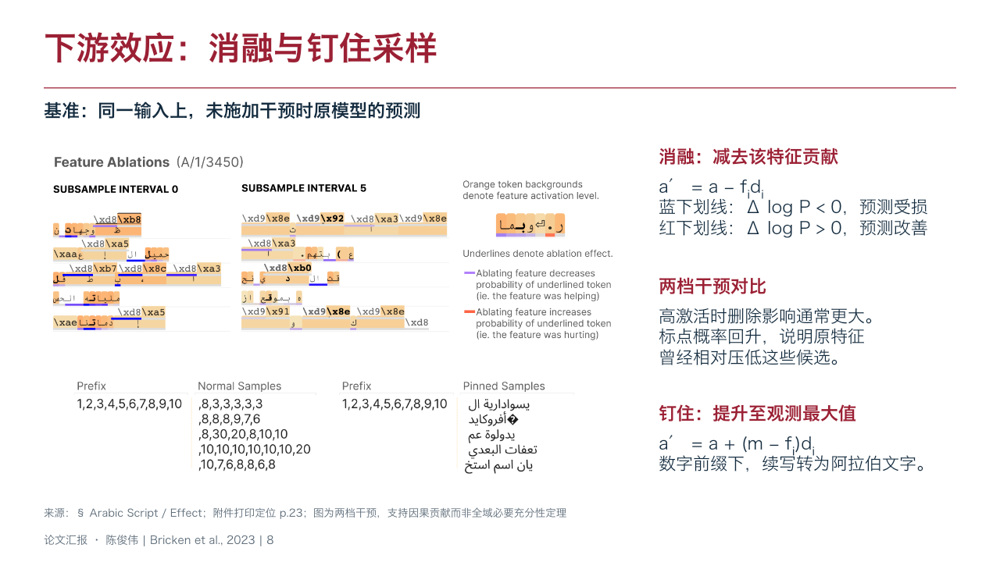
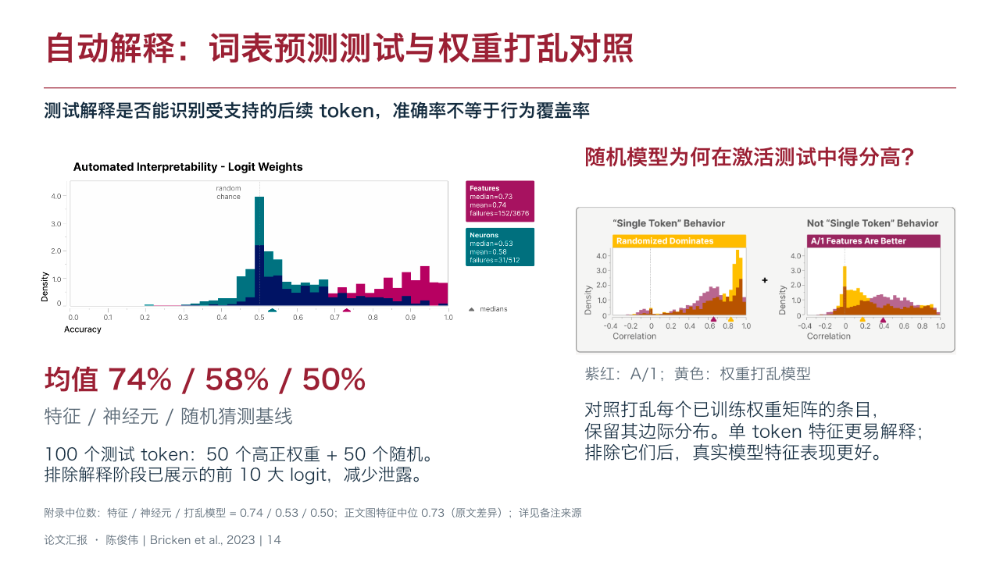

# Towards Monosemanticity：稀疏自编码器实验图文导读

面向熟悉基础神经网络、初次接触稀疏自编码器（SAE）与机制可解释性研究的中文学习资料。围绕 Anthropic 2023 年论文的实验部分，说明每项实验的目的、设置、图表读法与结论边界。

**汇报整理：陈俊伟** · **18 页 PPT** · **逐页口播与详细解析** · **建议汇报约 26 分钟**

[下载 PPT](reports/sae-experiments.pptx) · [阅读演讲稿](docs/speaker-notes.md) · [浏览全部幻灯片](docs/slides.md) · [概念速查](docs/concepts.md) · [实验口径校准](docs/experiment-notes.md)

## 这份资料讲什么

原论文尝试用 SAE 将一层语言模型中的 MLP 激活分解为更容易解释的特征，再通过语境统计、输出效应、实际干预与整体评估检查这些特征。

这份导读沿着实验的证据顺序展开：

- **建立分析对象。** 区分随文本变化的特征强度、固定的解码方向，以及编码器负责的检测条件。
- **看懂个案图表。** 以阿拉伯文字特征为主线，理解激活直方图、logit 权重、消融与钉住采样。
- **检查替代解释。** 比较特征与神经元，寻找不同初始化模型中的对应特征。
- **判断整体证据。** 阅读人工评分、自动解释测试、权重打乱对照与损失恢复实验。

原论文及研究结论的来源是 [Bricken et al., *Towards Monosemanticity: Decomposing Language Models With Dictionary Learning*](https://transformer-circuits.pub/2023/monosemantic-features/)。本仓库提供中文讲解、汇报文件及阅读辅助材料，没有运行语言模型训练或 SAE 训练，不包含自行复现的实验结果。

## 三组图，理解实验怎样支持结论

### 1. 激活与语境是否对应

先看横轴上的激活强度，再看颜色代表的语境证据，最后读底部的条件分布。峰高不能直接当成样本比例；零激活的质量也需要单独考虑。

这张图检查特征响应与目标语境的关系。代理分数由研究者定义，仍可能受到标点、分词和字节碎片的影响。详细读法见[第 6 页解析](docs/speaker-notes.md)，原始证据见论文的 [Arabic Script: Activations](https://transformer-circuits.pub/2023/monosemantic-features/index.html#feature-arabic-activations) 与 [Sensitivity](https://transformer-circuits.pub/2023/monosemantic-features/index.html#feature-arabic-sensitivity)。

### 2. 改写特征贡献，输出是否改变

消融从原始激活中减去某个特征的向量贡献；钉住采样则提高该方向的强度并观察续写。两类操作把语境相关性推进到具体上下文中的因果检验。

删除后某些预测受损，支持该方向对这些预测有贡献；提高激活后出现相关文字，支持该方向能推动相应行为。推论仍受上下文、干预强度与特征冗余限制。见[逐页解析](docs/speaker-notes.md)及论文的 [Arabic Script: Effect](https://transformer-circuits.pub/2023/monosemantic-features/index.html#feature-arabic-effect)。

### 3. 自动解释测试测量了什么

解释需要能预测新的激活或后续 token。测试得分还会受到样本构造、稀疏性和单 token 特征的影响，因此应同时阅读不同评估方式与对照。

图中均值 **74% / 58%** 对应特征与神经元在词表预测测试中的准确率，**50%** 是随机猜测基线。它们不表示解释了相同比例的模型行为。原始设置见 [Automated Interpretability: Logits](https://transformer-circuits.pub/2023/monosemantic-features/index.html#global-analysis-interp-auto-logits)；单 token 行为的对照见 [Randomized Model Analysis](https://transformer-circuits.pub/2023/monosemantic-features/index.html#appendix-automated-randomized)。

## 如何使用

**准备汇报：** 下载 [PPT](reports/sae-experiments.pptx)，配合[逐页演讲稿与详细解析](docs/speaker-notes.md)阅读。每页有独立口播、解释与来源；概念表和架构图位于第 17–18 页，可留作答疑备用。

**自行学习：** 从[完整幻灯片预览](docs/slides.md)开始，遇到陌生符号时查看[概念速查](docs/concepts.md)，再回到原论文图表与章节。

**核对数字：** 先读[实验口径校准](docs/experiment-notes.md)。打印页码沿用汇报准备材料中的定位，原文核验使用每页解析中的网页章节锚点。

## 阅读时需要区分的口径

- 人工评分的 **11 档**与自动解释流程的 **13 档**属于不同设置。
- **88% / 54%** 是随机评估样本中零激活比例的跨单元均值，不是每个稀疏码固定的零元素比例。
- 固定方向的 logit 效应表采用 **LayerNorm 线性近似**，不能当成完整前向计算的精确线性映射。
- 正文图中的特征中位数 **0.73** 与附录文字 **0.74** 存在差异，资料中保留了这一区别。
- **79% / 94.5%** 是相对 MLP 清零消融基线的损失改善恢复比例，不是可解释行为覆盖率。

具体定义、比较对象和原文来源见[实验口径校准](docs/experiment-notes.md)。

## 文件导航

- [`reports/sae-experiments.pptx`](reports/sae-experiments.pptx)：可编辑的 18 页汇报，含逐页演讲备注。
- [`docs/speaker-notes.md`](docs/speaker-notes.md)：逐页口播、详细解析、原文定位与 6 个预设问答。
- [`docs/slides.md`](docs/slides.md)：全部幻灯片的图文预览。
- [`docs/concepts.md`](docs/concepts.md)：概念、符号和矩阵形状速查。
- [`docs/experiment-notes.md`](docs/experiment-notes.md)：实验设置、统计口径和结论边界。
- [`assets/slides/`](assets/slides/)：供网页阅读的幻灯片 PNG。
- [`THIRD_PARTY_NOTICES.md`](THIRD_PARTY_NOTICES.md)：论文、原图与其他第三方材料的来源说明。

## 贡献与引用

欢迎通过 Issue 指出翻译、数字口径、图表解释或链接问题。涉及论文事实时，请附上原文章节链接，并说明建议修改的位置。修改图表说明时，应保留比较对象、样本范围、统计量与近似条件。

引用研究结论时，请引用[原论文](https://transformer-circuits.pub/2023/monosemantic-features/)。使用本仓库的中文讲解或汇报文件时，可注明“陈俊伟，《Towards Monosemanticity：稀疏自编码器实验图文导读》”，并附上仓库链接。

## 许可与来源

[MIT License](LICENSE) 适用于本仓库原创的中文讲解、代码与配置。论文原图及其在 PPT、幻灯片截图中的嵌入部分不属于本仓库 MIT 许可的授权范围，相关权利归原权利人。出处与材料范围见 [THIRD_PARTY_NOTICES.md](THIRD_PARTY_NOTICES.md)。

本仓库为独立整理的学习资料，不代表 Anthropic 官方文档。
