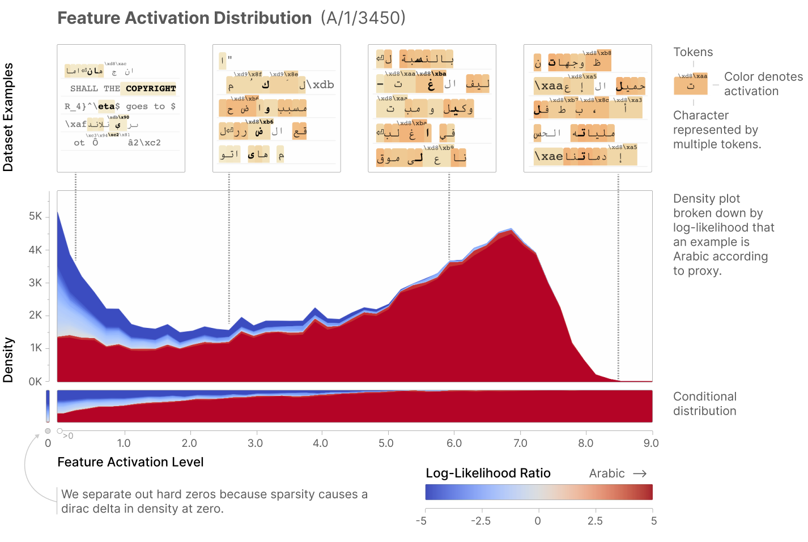
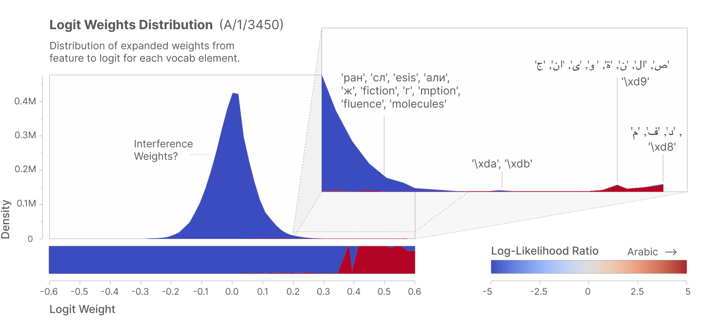
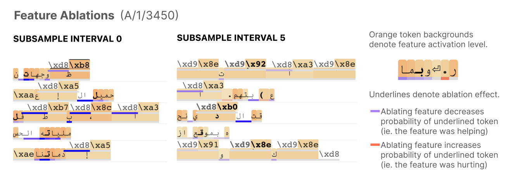
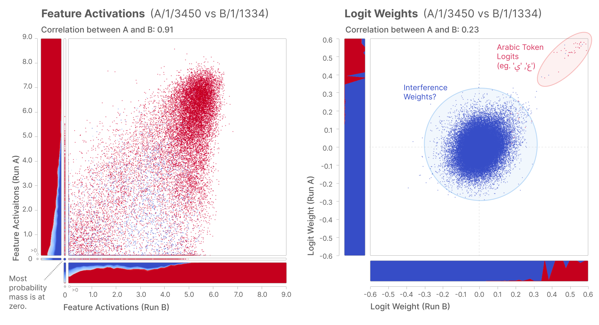
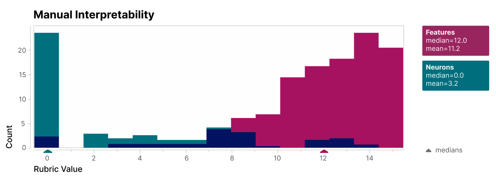
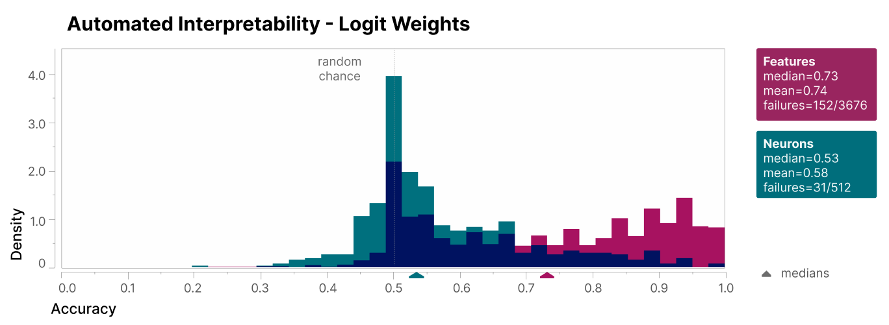
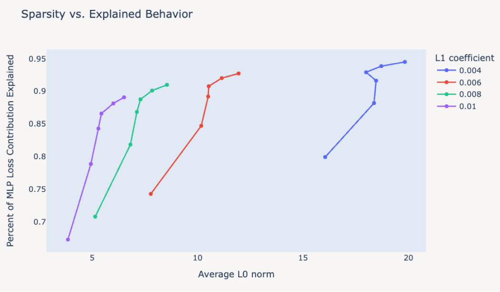

# 实验读图与数字口径

这份笔记按“激活解释、输出效应、实际干预、替代解释与整体评估”组织证据。所有数值来自原论文；本仓库提供中文解读和汇报材料，没有重新训练语言模型或 SAE。完整逐页讲解见 [演讲稿与详细解析](speaker-notes.md)。

## 共同设置

研究对象是一层 Transformer：残差流 128 维、MLP 512 个神经元，语言模型使用 The Pile 的 100B token 训练。SAE 另用约 8B 个 MLP 激活向量训练。重点字典 A/1 包含 4,096 个特征，最大字典 A/5 包含 131,072 个特征。语言模型训练量、SAE 样本量和字典宽度是三个不同计数。

重点个案分别为阿拉伯文字 A/1/3450、DNA A/1/2937、base64 A/1/2357、希伯来文字 A/1/416。作者明确承认这些个案经过挑选；典型性需要后续抽样评估支持。[设置与编号](https://transformer-circuits.pub/2023/monosemantic-features/index.html#setup-notation)

## 1. 激活是否对应可解释的语境

原图来源：Anthropic，[Arabic Script / Activations](https://transformer-circuits.pub/2023/monosemantic-features/index.html#feature-arabic-activations)。

**目的与做法。** 对每个 token 计算特征强度与程序生成的语境代理，再按激活分箱、按代理分数着色。

**读图顺序。** 横轴是激活，纵轴是密度。先看 0–1 附近的低激活区，再看激活大于 5 的区域；红色代表阿拉伯文字证据更强。底部条是给定激活后的条件分布，左侧细竖条单独表示严格为零的概率质量。

**关键读数。** 阿拉伯文字占总体训练 token 的 0.13%，占特征点火位置的约 81%；激活大于 5 时，目标比例约 98%。刚点火处的目标比例约 25%。这几个比例的条件不同，不能互换。

峰高不是样本比例。81% 与补集约 19% 是所有点火样本的语义分组，不能机械对应为两个完全分离的峰各自所占面积。

约 40M token 上，特征激活与阈值化代理的 Pearson 相关为 0.74。这同时涉及敏感性、特异性和激活幅值，不是“召回率 74%”。代理也可能错判空格、标点或字节碎片。[敏感性分析](https://transformer-circuits.pub/2023/monosemantic-features/index.html#feature-arabic-sensitivity)

## 2. 激活方向是否影响合理的后续输出

原图来源：Anthropic，[Arabic Script / Effect](https://transformer-circuits.pub/2023/monosemantic-features/index.html#feature-arabic-effect)。

**目的与做法。** 取固定解码方向，经 MLP 输出矩阵、近似 LayerNorm、反嵌入矩阵映射到词表，再减去中位数、绘制直方图。固定近似矩阵后，绘图不需要新的输入文本。

**读图。** 零附近的大峰包含很多非目标词；右侧较小的模式聚集阿拉伯文字相关 token，包括 UTF-8 首字节。底部颜色条将权重位置与 token 属性对应起来。中央峰来自叠加干扰是作者的解释，不是已独立证明的噪声定理。

**近似边界。** 本仓库使用 $w_i\approx W_U L\pi W_{\mathrm{out}}d_i$。真实 LayerNorm 随当前残差状态改变，因此不能把“绘图是固定矩阵运算”写成“真实模型从激活到 logits 完全线性”。中位数归零只移除公共平移，也不能保证所有正权重 token 在每个上下文中概率都提高。

## 3. 删除与提高强度是否改变行为

原图来源：Anthropic，[下游效应](https://transformer-circuits.pub/2023/monosemantic-features/index.html#feature-arabic-effect)。

**基准。** 同一输入上未干预模型的输出。

**删除。** 在原始激活中减去 $f_i d_i$，再计算 $\Delta\log P=\log P_{\mathrm{ablated}}-\log P_{\mathrm{orig}}$。蓝紫下划线表示删除后预测受损，红橙表示改善。背景标记激活的位置，下划线标记随后被预测的位置，两者可能相邻错开。

**读图。** 原图展示两个激活档，而非一条完整连续剂量曲线。较强档中，删除的影响通常更大；部分标点概率回升，表明原特征相对抑制过这些候选。

**提高强度。** 生成时持续把特征强度设为最大观测值，数字前缀之后的续写转为阿拉伯文字。它支持该方向的因果贡献，不能额外保证续写具有正确阿拉伯语语法或语义。

删除与注入分别接近必要性、充分性的操作性问题，但不证明特征在全部上下文中唯一必要或单独充分。[消融方法](https://transformer-circuits.pub/2023/monosemantic-features/index.html#appendix-feature-ablations)

## 4. 特征是否只是单神经元的重新命名

检查应同时覆盖方向、激活和输出权重。若某特征只是神经元 $j$，应看到解码方向接近坐标轴 $e_j$、激活近乎同步、输出效应也接近。

阿拉伯文字个案中，27 个解码系数满足绝对值不小于 0.1，幅值最大的前三项均为负。它与最相关神经元 489 的激活相关为 **0.09**，logit 权重相关为 **0.21**。base64 与其最相关神经元的激活相关为 0.18，希伯来文字个案为 0.10；不能用“全部在 0.1–0.18”概括阿拉伯文字的 0.09。[非神经元检验](https://transformer-circuits.pub/2023/monosemantic-features/index.html#feature-arabic-neuron)

这支持所测个案区别于单神经元，不排除其他特征可能与某个神经元高度对齐。

## 5. 不同训练是否会出现相似特征

原图来源：Anthropic，[Arabic Script / Universality](https://transformer-circuits.pub/2023/monosemantic-features/index.html#feature-arabic-universality)。

**做法。** 基础模型 B 保持架构和训练设置，只改变初始化随机种子。在 B/1 中找与 A 侧特征激活 Pearson 相关最高的对象。对应 SAE 运行超参数相同，但训练激活来自不同 token。

四个个案的最高匹配激活相关为：阿拉伯文字 0.91、DNA 0.92、base64 0.85、希伯来文字 0.92。

**左图看对角线红带。** 它说明 A/1/3450 与 B/1/1334 在相似语境同步激活，相关为 **0.91**。

**右图看红色离群结构。** 整体 logit 权重相关只有 **0.23**，但高正权重阿拉伯 token 在两个模型中重现。干扰项的差异会降低整体相关。

0.09 比较“特征与神经元”，0.91 比较“特征与另一模型的特征”，两者回答不同问题。全字典最高匹配激活相关的中位数是特征 0.72、神经元 0.46；这里不是解码向量余弦相似度，也不是 72% 的特征完全相同。[全局普遍性](https://transformer-circuits.pub/2023/monosemantic-features/index.html#phenomenology-universality)

## 6. 人工评估：11 档，不是 13 档

原图来源：Anthropic，[人工可解释性评估](https://transformer-circuits.pub/2023/monosemantic-features/index.html#global-analysis-interp-manual)。

人工评估排除 168 个死特征和 292 个超低密度特征，在 0 到最大激活间设置 **11 个等距区间**。总共完成 **412 次区间评分，覆盖 162 个特征或神经元**；不是对 162 个单元的所有区间逐一评分。

评分依次形成解释、评解释信心、激活一致性、正 logit 一致性、效应分离性和解释特异性。正 logit 一致性满分时，额外分离性项不计，所以满分为 **14**。神经元中位分为 **0**，特征区间中位分为 **12**。

单元身份经过盲化，但评分者只有一人，而且是作者 Adam Jermyn。不能因此称为独立第三方、多标注者一致性评估。[Rubric](https://transformer-circuits.pub/2023/monosemantic-features/index.html#appendix-rubric)

## 7. 自动激活解释：13 档与零激活比例

自动解释流程使用最高档加其他 12 档，共 **13 档**。Claude 2 先根据最多 49 个样例和输出权重生成解释，再在独立交互中依据解释预测未见文本的激活。测试通常最多 60 条、每条 9 token，即 540 项；真实激活量化为 0–9，以 Spearman 排序相关评分。原文图中的中位分数为特征 0.58、神经元 0.20。[自动激活评估](https://transformer-circuits.pub/2023/monosemantic-features/index.html#global-analysis-interp-auto-acts)

**88% 与 54% 的对象。** 在自动评估的随机样例中，先计算各单元真实激活为零的比例，再跨单元取均值：特征为 88%，神经元为 54%；中位约 91% 与 58%。这不是每个 4,096 维稀疏码固定有 88% 坐标为零。

重要性加权试图还原自然样本比例，但极稀疏时零激活样例可能主导分数，使过窄解释受益。应同时检查正激活行为，而不能仅依赖重加权后的总分。[重要性评分](https://transformer-circuits.pub/2023/monosemantic-features/index.html#appendix-automated-importance-scoring)

## 8. 自动 logit 解释：均值、中位数与两个 50%

原图来源：Anthropic，[自动 logit 评估](https://transformer-circuits.pub/2023/monosemantic-features/index.html#global-analysis-interp-auto-logits)。

测试让解释预测哪些词表 token 是合理后续输出。每单元使用 50 个高正权重 token 与 50 个随机 token，排除解释阶段已经展示的前 10 大 logit 项。随机样本不是“全部负权重项”的同义词。

- **正文均值**：特征 74%，神经元 58%。
- **理论随机猜测基线**：50%。
- **附录中位数**：特征 0.74、神经元 0.53、权重打乱模型 0.50。
- **正文图内部读数**：特征标注 median=0.73、mean=0.74；附录文字则写 median=0.74。本仓库保留这处差异，主讲采用一致的均值 74%/58%。

两个 50% 分别是理论基线与打乱模型的实测中位数。74% 是具体解释测试的平均准确率，不能写成“解释了模型 74% 的行为”。[自动评估附录](https://transformer-circuits.pub/2023/monosemantic-features/index.html#appendix-automated-setup)

**权重打乱对照。** 对照模型将已训练 A 的各权重矩阵内部条目随机打乱，保留数值的边际分布。它在激活解释测试中可能得到更高分，主要因为更多特征只响应单个 token，测试较容易。排除这类特征后，真实模型的复杂上下文特征更有优势。不能把这个对照描述成“随机初始化后、未学过语言的模型”。[随机对照与拆解](https://transformer-circuits.pub/2023/monosemantic-features/index.html#appendix-automated-randomized)

## 9. 稀疏性、特征分裂与损失恢复

原图来源：Anthropic，[超参数与恢复比例](https://transformer-circuits.pub/2023/monosemantic-features/index.html#appendix-hyperparameters)。

图的横轴是 **平均 L0，即每 token 平均非零特征数**，纵轴是相对 MLP 清零基线恢复的 loss 改善比例，颜色表示 L1 系数。横轴不是字典总大小。

恢复比例使用原模型、MLP 清零、SAE 重构替换三个状态：

$$
R=\frac{L_{\mathrm{zero}}-L_{\mathrm{SAE}}}
{L_{\mathrm{zero}}-L_{\mathrm{orig}}}.
$$

A/1 的恢复比例为 **79%**；A/5（131,072 特征、L1 系数 0.004）为 **94.5%**。原文明确要求保留 “grain of salt” 限定：该指标依赖清零基线，且部分特征仍多义或难解释。重构忠实性与解释质量是不同要求，不能把恢复比例当作已解释行为占比，也不能与自动解释准确率相乘。[恢复比例的含义](https://transformer-circuits.pub/2023/monosemantic-features/index.html#global-analysis-how-much)

扩大字典时，base64 在 A/0 中的一个较宽泛特征，在 A/1 中由三个更具体特征共同覆盖。特征分裂说明描述粒度随字典规模改变。FSA 式现象则通过生成 token 串联后续特征，属于跨 token 的结构观察，不是对完整形式自动机的证明。[特征分裂](https://transformer-circuits.pub/2023/monosemantic-features/index.html#phenomenology-feature-splitting) · [FSA 式结构](https://transformer-circuits.pub/2023/monosemantic-features/index.html#phenomenology-fsa)

## 使用这些结论时的范围

实验支持 SAE 在这类单层小模型中提供比单神经元更清楚的分析单位，不能直接推出任意大模型、任意层都能同等分解。个案经过挑选、人工评分是单标注者、输出效应依赖近似、字典中部分特征仍多义，这些限制都应随结论一起保留。

所有原图及其嵌入部分的权利归原权利人，具体说明见 [第三方素材说明](../THIRD_PARTY_NOTICES.md)。

继续阅读：[概念与符号](concepts.md) · [参考文献与定位](references.md)
