# 18 页幻灯片与逐页口播

[返回首页](../README.md) · [下载可编辑 PPT](../reports/sae-experiments.pptx) · [完整演讲稿、详细解析与 Q&A](speaker-notes.md)

16 页正文与 2 页附录。建议总时长约 26 分 20 秒，含读图与停顿。每页口播与 PPT 备注对应，公式及方法细节见完整解析。

## 页面导航

- [01 · 稀疏自编码器的实验设计与证据](#slide-01)
- [02 · 一次前向传播中的激活分解](#slide-02)
- [03 · 模型、数据与字典运行](#slide-03)
- [04 · 特征强度、写入方向与代理分数](#slide-04)
- [05 · 四个个案特征与五项检验](#slide-05)
- [06 · 激活分布中的特异性与敏感性](#slide-06)
- [07 · logit 权重给出的输出倾向](#slide-07)
- [08 · 删除与钉住特征的干预](#slide-08)
- [09 · 下游效应的三步证据](#slide-09)
- [10 · 特征与单个神经元的区别](#slide-10)
- [11 · 跨随机种子的特征重现](#slide-11)
- [12 · 人工评分中的整体可解释性](#slide-12)
- [13 · 自动解释：预测未见文本的激活](#slide-13)
- [14 · 输出预测测试与权重打乱对照](#slide-14)
- [15 · 字典规模、特征结构与损失恢复](#slide-15)
- [16 · 结论与适用边界](#slide-16)
- [17 · 附录：概念与首次出现位置](#slide-17)
- [18 · 附录：模型主线、SAE 支路与观测点](#slide-18)

---

## 01 · 稀疏自编码器的实验设计与证据

建议用时：40 秒。

今天汇报 Anthropic 的《Towards Monosemanticity》，作者是 Bricken 等人，我是陈俊伟。我们只讨论实验部分：研究者怎样从模型内部激活中提取可解释特征，以及怎样检查这些解释。核心方法是稀疏自编码器，也就是用少量非零系数重构原始激活的神经网络。本次先看四个个案，再看随机抽样的整体评估，最后看字典规模与损失恢复。每个实验都按目的、设置、读图和结论展开，区分相关证据与实际干预，也明确每个数字能支持到什么程度。

原文定位：

- [feature-analysis](https://transformer-circuits.pub/2023/monosemantic-features/index.html#feature-analysis)
- [global-analysis](https://transformer-circuits.pub/2023/monosemantic-features/index.html#global-analysis)

[回到导航](#页面导航)

---

## 02 · 一次前向传播中的激活分解

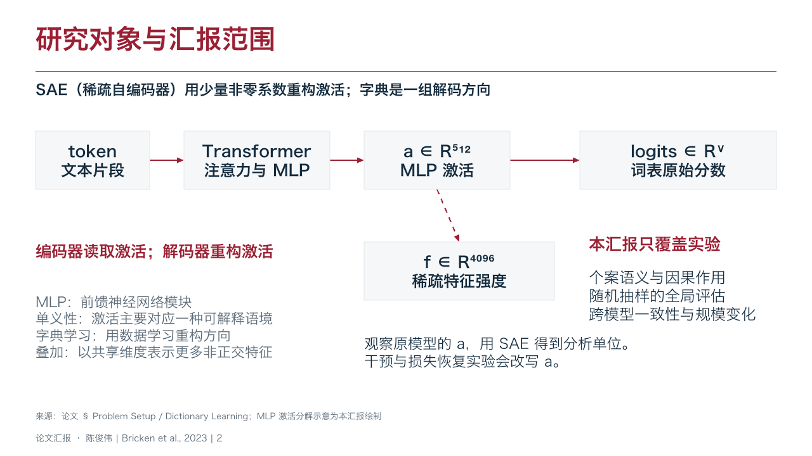

建议用时：60 秒。

先明确我们观察的位置。输入文本经过嵌入与注意力后，MLP 产生一个五百一十二维激活向量。SAE 的编码器读取这个向量，给出四千零九十六个非负特征强度，解码器再把它们组合成原激活的近似。编码器决定何时激活，解码器决定激活后沿哪个方向影响模型。叠加假说认为，模型可以在较少神经元中表示更多特征。实验要检验这种分解是否可解释、是否影响输出，以及它是否优于逐个查看神经元。接下来先固定模型规模和符号。

原文定位：

- [problem-setup-decomposition](https://transformer-circuits.pub/2023/monosemantic-features/index.html#problem-setup-decomposition)
- [setup-autoencoder](https://transformer-circuits.pub/2023/monosemantic-features/index.html#setup-autoencoder)
- [feature-analysis](https://transformer-circuits.pub/2023/monosemantic-features/index.html#feature-analysis)

[回到导航](#页面导航)

---

## 03 · 模型、数据与字典运行

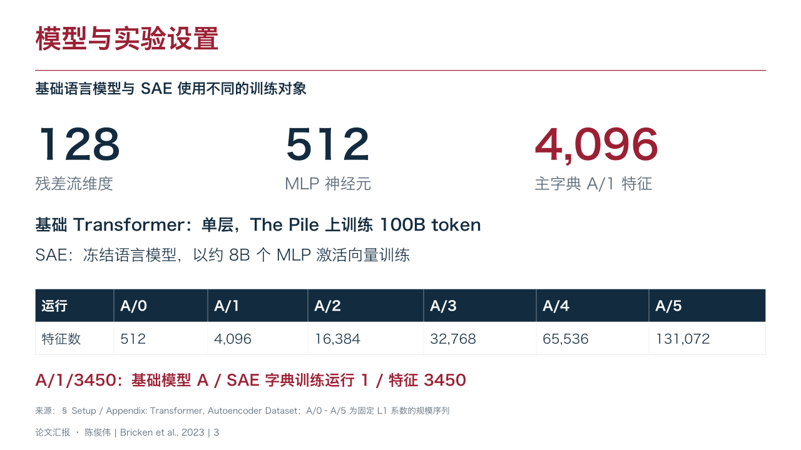

建议用时：80 秒。

被研究模型只有一层 Transformer，残差流一百二十八维，MLP 有五百一十二个 ReLU 神经元，使用 The Pile 的一千亿个 token 训练。SAE 另用约八十亿个 MLP 激活向量训练，因此语言模型训练量与 SAE 样本量是两回事。A、B 表示两个随机种子下的模型，斜杠后的编号表示字典学习运行。主要分析 A/1，它有四千零九十六个特征；A/0 到 A/5 在固定稀疏惩罚下扩大字典，最大为十三万一千零七十二。下面用统一符号说明一个特征到底是什么。

原文定位：

- [setup-transformer](https://transformer-circuits.pub/2023/monosemantic-features/index.html#setup-transformer)
- [setup-notation](https://transformer-circuits.pub/2023/monosemantic-features/index.html#setup-notation)
- [appendix-transformer](https://transformer-circuits.pub/2023/monosemantic-features/index.html#appendix-transformer)
- [appendix-autoencoder-dataset](https://transformer-circuits.pub/2023/monosemantic-features/index.html#appendix-autoencoder-dataset)
- [appendix-autoencoder-resampling](https://transformer-circuits.pub/2023/monosemantic-features/index.html#appendix-autoencoder-resampling)

[回到导航](#页面导航)

---

## 04 · 特征强度、写入方向与代理分数

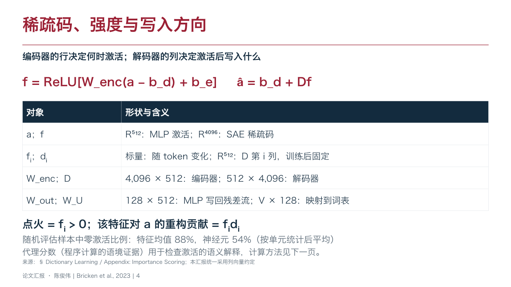

建议用时：110 秒。

一个特征包含两个不同对象。特征强度会随 token 变化，超过零就称为点火；解码方向在训练后固定，它与强度相乘才是该特征的向量贡献。编码器的一行负责检测，解码器的一列负责写入，两者并不要求相同。代理分数是研究者另外写出的程序，用对数似然比衡量文本符合某个假设的证据，不是模型给出的真值。随机样本中，特征零激活比例的跨单元均值为百分之八十八，神经元为百分之五十四；这不能直接当作每个稀疏码的零元素比例。

原文定位：

- [problem-setup-decomposition](https://transformer-circuits.pub/2023/monosemantic-features/index.html#problem-setup-decomposition)
- [setup-notation](https://transformer-circuits.pub/2023/monosemantic-features/index.html#setup-notation)
- [appendix-proxies](https://transformer-circuits.pub/2023/monosemantic-features/index.html#appendix-proxies)
- [appendix-automated-importance-scoring](https://transformer-circuits.pub/2023/monosemantic-features/index.html#appendix-automated-importance-scoring)

[回到导航](#页面导航)

---

## 05 · 四个个案特征与五项检验

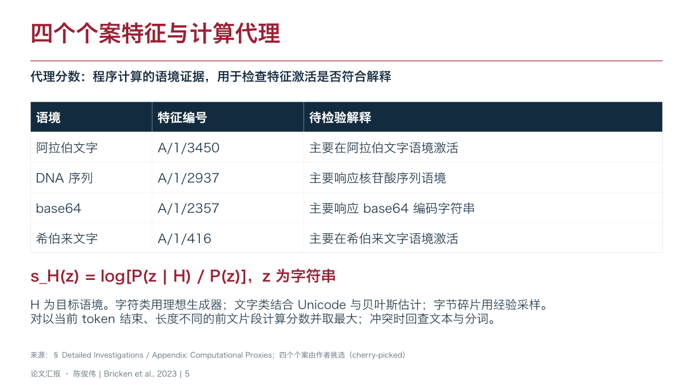

建议用时：60 秒。

论文选择四个容易建立计算代理的语境：阿拉伯文字、DNA、base64 和希伯来文字。阿拉伯文字包含使用同一文字系统的多种语言，不能仅叫阿拉伯语；base64 则是编码文本，不是自然语言。四个特征分别检查在哪里激活、目标语境是否被覆盖、怎样影响输出、是否只是某个神经元，以及另一个模型中能否重现。作者明确承认这些个案经过挑选，所以它们用于展示证据如何成立，不能代表全部特征。下面以阿拉伯文字为主线，先看激活与语境的对应关系。

原文定位：

- [feature-analysis](https://transformer-circuits.pub/2023/monosemantic-features/index.html#feature-analysis)
- [feature-arabic](https://transformer-circuits.pub/2023/monosemantic-features/index.html#feature-arabic)
- [feature-dna](https://transformer-circuits.pub/2023/monosemantic-features/index.html#feature-dna)
- [feature-base64](https://transformer-circuits.pub/2023/monosemantic-features/index.html#feature-base64)
- [feature-hebrew](https://transformer-circuits.pub/2023/monosemantic-features/index.html#feature-hebrew)

[回到导航](#页面导航)

---

## 06 · 激活分布中的特异性与敏感性

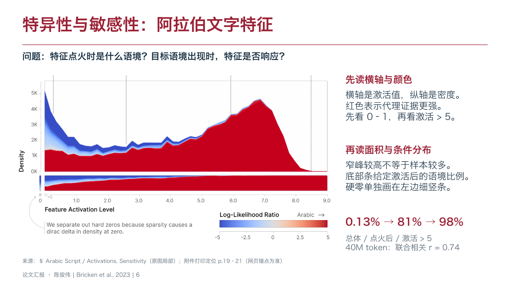

建议用时：130 秒。

这张图的横轴是特征激活，纵轴是密度，颜色表示外部代理提供的阿拉伯文字证据。先看零到一附近，较弱激活混入较多非目标文本；再看超过五的区间，目标比例达到百分之九十八。全部训练 token 中阿拉伯文字仅占百分之零点一三，而点火位置中占百分之八十一。峰高不能直接当作比例，底部色条才展示给定激活下的条件分布。左侧细条另画恰为零的质量。四千万个 token 上，激活与阈值化代理的相关为零点七四，它同时涉及敏感性与特异性。

原文定位：

- [feature-arabic-activations](https://transformer-circuits.pub/2023/monosemantic-features/index.html#feature-arabic-activations)
- [feature-arabic-sensitivity](https://transformer-circuits.pub/2023/monosemantic-features/index.html#feature-arabic-sensitivity)

[回到导航](#页面导航)

---

## 07 · logit 权重给出的输出倾向

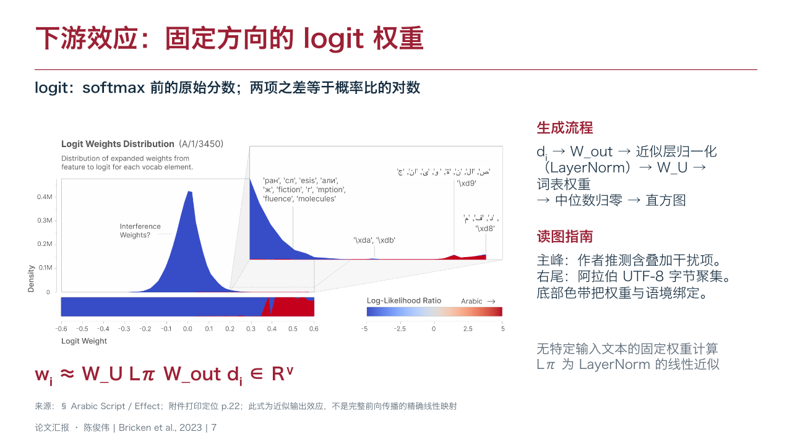

建议用时：130 秒。

前一页看输入侧，这一页问特征激活后会怎样影响输出。logit 是 softmax 之前每个词表 token 的分数。固定特征方向后，将它依次经过 MLP 输出投影、近似归一化和反嵌入，就得到一组词表权重，再减去中位数画出分布。绘图阶段不需要新的输入文本，但这依赖 LayerNorm 的线性近似。先看零附近的大峰，再看右侧离群的阿拉伯文字及字节 token。它们获得较高相对权重，说明写入方向与解释一致；是否实际改变预测，还需下一页的干预。

原文定位：

- [feature-arabic-effect](https://transformer-circuits.pub/2023/monosemantic-features/index.html#feature-arabic-effect)

[回到导航](#页面导航)

---

## 08 · 删除与钉住特征的干预

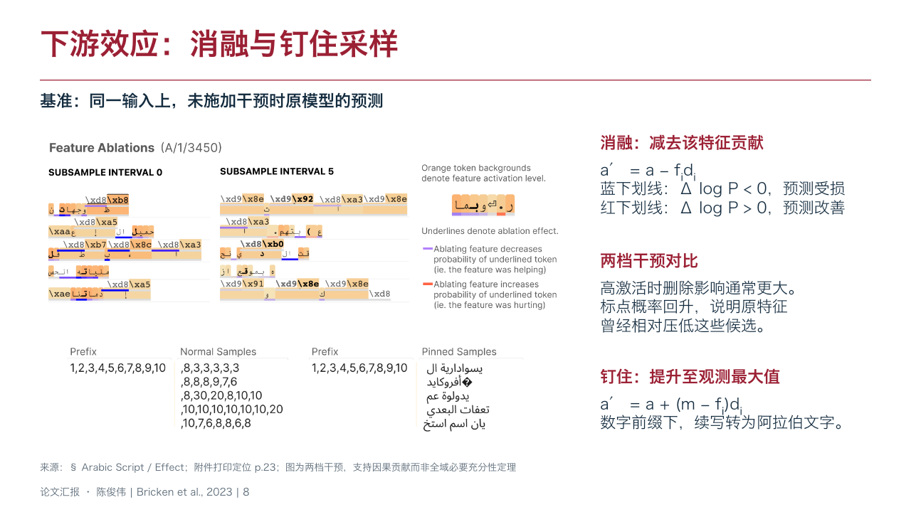

建议用时：130 秒。

实际干预以同一文本、未改动模型的输出为基准。消融是在原始 MLP 激活中减去该特征的强度乘方向，再继续前向传播。蓝紫下划线表示删除后预测变差，红橙下划线表示变好。注意背景标记激活位置，下划线标记随后被预测的位置，两者可能相邻错开。原图比较两个激活档，较强档的删除影响更大。另一项实验从数字前缀开始，把特征钉到最大观测激活，模型便生成阿拉伯文字。这两种干预支持因果贡献，但不足以证明它独自负责所有相关行为。

原文定位：

- [feature-arabic-effect](https://transformer-circuits.pub/2023/monosemantic-features/index.html#feature-arabic-effect)
- [appendix-feature-ablations](https://transformer-circuits.pub/2023/monosemantic-features/index.html#appendix-feature-ablations)

[回到导航](#页面导航)

---

## 09 · 下游效应的三步证据

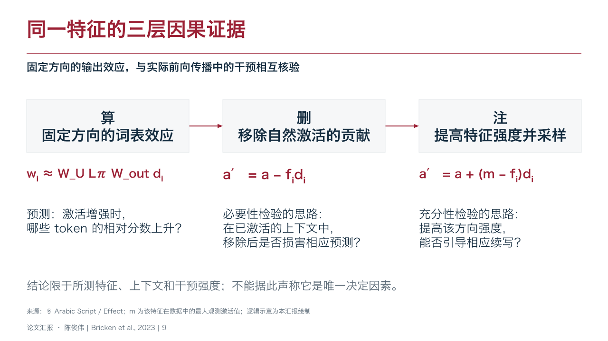

建议用时：60 秒。

现在把三步证据放在一起。第一步计算输出权重，检查这个方向是否支持与解释一致的词表 token。第二步在真实上下文删除它，看相应预测是否受损。第三步提高它的强度，看生成是否出现相应变化。第一步依赖线性近似，后两步直接运行干预后的模型，因此它们能补充彼此的限制。三者共同支持特征与模型功能有关，而不只是文本中存在某种统计相关。接下来还要排除另一种解释：SAE 是否只是把一个原本就很清楚的神经元重新命名了。

原文定位：

- [feature-arabic-effect](https://transformer-circuits.pub/2023/monosemantic-features/index.html#feature-arabic-effect)
- [global-analysis-about-model](https://transformer-circuits.pub/2023/monosemantic-features/index.html#global-analysis-about-model)

[回到导航](#页面导航)

---

## 10 · 特征与单个神经元的区别

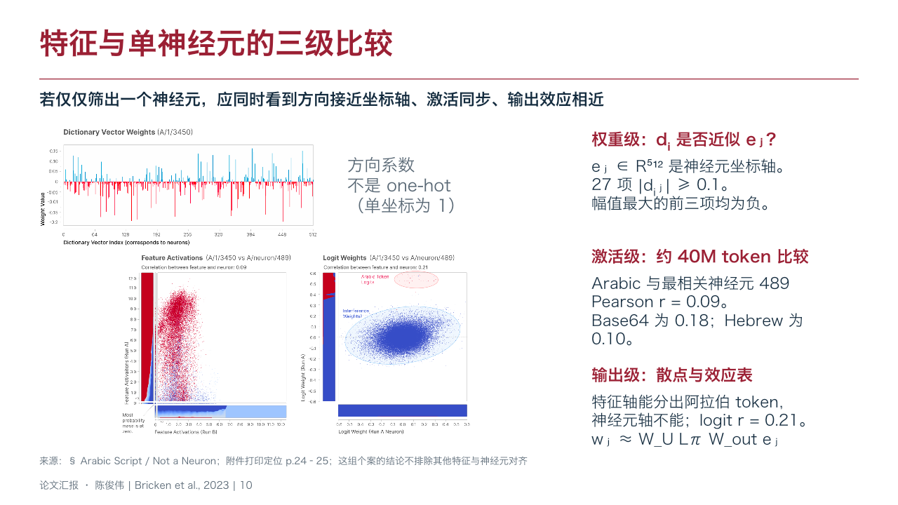

建议用时：110 秒。

如果这个特征只是某个神经元，那么它的解码方向应接近那个坐标轴，两者在真实文本上的激活也应高度同步。论文分三层检查。方向系数并非只有一个非零值，二十七个神经元的系数绝对值至少为零点一，最大的三个绝对系数都为负。约四千万个 token 上，最相关的神经元是四百八十九号，但阿拉伯文字特征与它的激活相关只有零点零九。输出散点中，特征轴能较好分开阿拉伯文字 token，神经元轴做不到。这说明该个案的分解具有非平凡的新增解释价值。

原文定位：

- [feature-arabic-neuron](https://transformer-circuits.pub/2023/monosemantic-features/index.html#feature-arabic-neuron)
- [feature-base64-neuron](https://transformer-circuits.pub/2023/monosemantic-features/index.html#feature-base64-neuron)
- [feature-hebrew-neuron](https://transformer-circuits.pub/2023/monosemantic-features/index.html#feature-hebrew-neuron)

[回到导航](#页面导航)

---

## 11 · 跨随机种子的特征重现

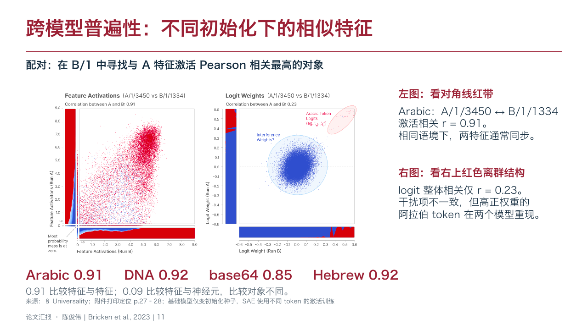

建议用时：100 秒。

普遍性实验训练另一个模型 B，保持架构、数据与超参数，改变随机种子。随后在 B 的字典中，按同一批 token 上的激活相关寻找最相似特征。四个个案分别得到零点九一、零点九二、零点八五和零点九二。左侧激活散点看目标语境是否沿对角线共同变化；右侧输出散点看高权重的目标 token 是否共同成为离群点。右图整体相关只有零点二三，不能因此忽略右上方共同结构。这里的零点九一比较两个模型的特征，上一页零点零九比较特征与神经元，对象不同。

原文定位：

- [feature-arabic-universality](https://transformer-circuits.pub/2023/monosemantic-features/index.html#feature-arabic-universality)
- [feature-dna-universality](https://transformer-circuits.pub/2023/monosemantic-features/index.html#feature-dna-universality)
- [feature-base64-universality](https://transformer-circuits.pub/2023/monosemantic-features/index.html#feature-base64-universality)
- [feature-hebrew-universality](https://transformer-circuits.pub/2023/monosemantic-features/index.html#feature-hebrew-universality)
- [phenomenology-universality](https://transformer-circuits.pub/2023/monosemantic-features/index.html#phenomenology-universality)

[回到导航](#页面导航)

---

## 12 · 人工评分中的整体可解释性

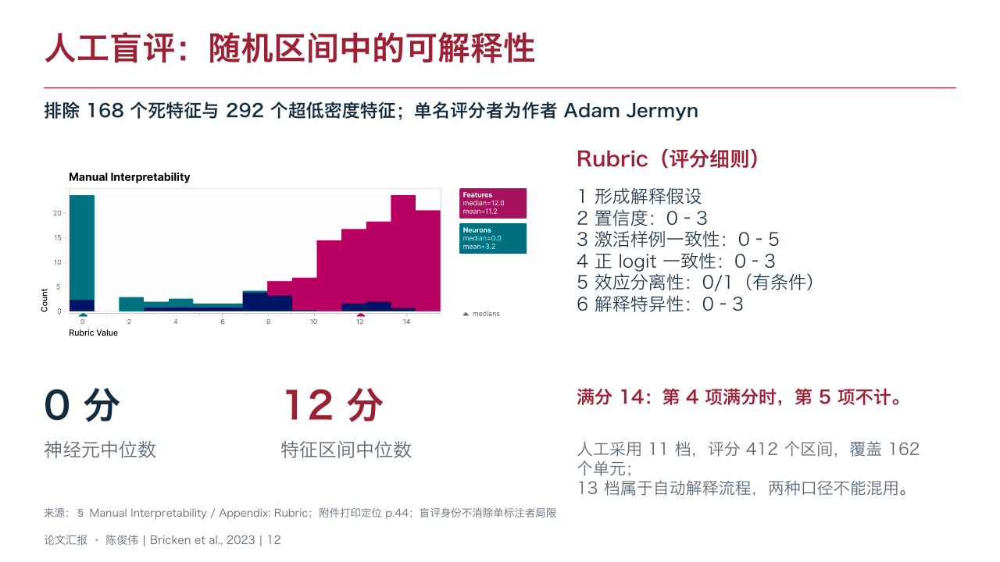

建议用时：110 秒。

为避免只展示挑选个案，论文对抽样特征和神经元进行人工评分。先排除死特征及超低密度特征，再覆盖不同激活强度，而不只看最大样例。这里人工评估明确使用十一个区间；十三个区间属于后面的自动解释流程，不能混用。最终四百一十二次区间评分覆盖一百六十二个单元。评分看解释信心、激活一致性、输出权重一致性和特异性，满分十四分。神经元中位为零，特征区间中位为十二。这支持整体差异，但只有一名作者标注，评分标准也含主观判断。

原文定位：

- [global-analysis-interp](https://transformer-circuits.pub/2023/monosemantic-features/index.html#global-analysis-interp)
- [global-analysis-interp-manual](https://transformer-circuits.pub/2023/monosemantic-features/index.html#global-analysis-interp-manual)
- [appendix-rubric](https://transformer-circuits.pub/2023/monosemantic-features/index.html#appendix-rubric)

[回到导航](#页面导航)

---

## 13 · 自动解释：预测未见文本的激活

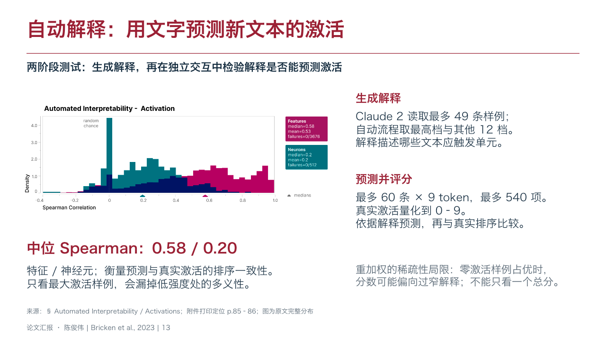

建议用时：95 秒。

自动解释把评估扩展到更多单元。第一阶段，Claude 阅读真实激活样例和输出权重，生成一段解释。第二阶段在新的交互中只使用解释，预测未见文本中各 token 的激活，再与真实值比较。测试覆盖十三个激活档及随机、脱离上下文的样例，总计通常六十段、五百四十个 token，用 Spearman 相关评分。特征比神经元更容易预测。重要性加权试图还原自然样本比例，却容易让大量零激活主导分数，因此一个总分不能代替对正激活行为的检查。下一页再从输出侧交叉验证。

原文定位：

- [global-analysis-interp-auto-acts](https://transformer-circuits.pub/2023/monosemantic-features/index.html#global-analysis-interp-auto-acts)
- [appendix-automated-setup](https://transformer-circuits.pub/2023/monosemantic-features/index.html#appendix-automated-setup)
- [appendix-automated-importance-scoring](https://transformer-circuits.pub/2023/monosemantic-features/index.html#appendix-automated-importance-scoring)

[回到导航](#页面导航)

---

## 14 · 输出预测测试与权重打乱对照

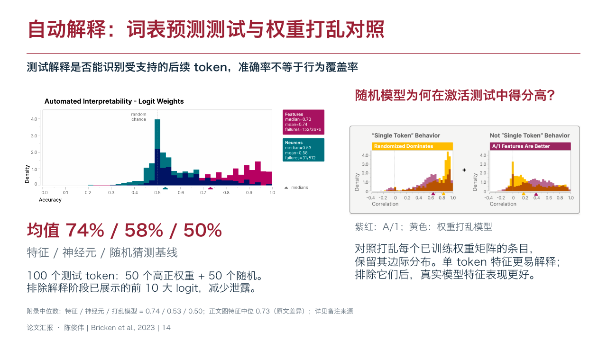

建议用时：115 秒。

输出版测试沿用已有解释，判断某个词表 token 是否是特征应支持的后续输出。考题由五十个高正权重 token 与五十个随机 token 构成，解释阶段见过的前十大权重项排除在测试外。正文报告特征平均百分之七十四，神经元百分之五十八，随机猜测基线百分之五十。附录的零点七四、零点五三和零点五零是中位数，最后一项来自权重打乱模型。打乱模型在激活预测中可能得分更高，主要由更容易解释的单 token 特征推动；这也说明必须把激活解释与输出解释一起检查。

原文定位：

- [global-analysis-interp-auto-logits](https://transformer-circuits.pub/2023/monosemantic-features/index.html#global-analysis-interp-auto-logits)
- [global-analysis-about-model](https://transformer-circuits.pub/2023/monosemantic-features/index.html#global-analysis-about-model)
- [appendix-automated-setup](https://transformer-circuits.pub/2023/monosemantic-features/index.html#appendix-automated-setup)
- [appendix-automated-randomized](https://transformer-circuits.pub/2023/monosemantic-features/index.html#appendix-automated-randomized)

[回到导航](#页面导航)

---

## 15 · 字典规模、特征结构与损失恢复

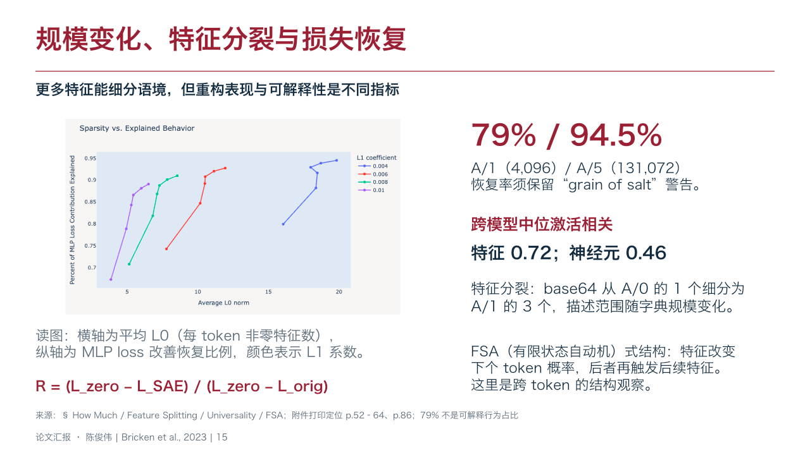

建议用时：100 秒。

扩大字典后，论文观察到较宽泛特征分成更细的特征。例如 base64 在五百一十二特征字典中主要由一个特征覆盖，在四千零九十六特征字典中分成三个，分别表现出字母、数字及编码 ASCII 文本等差异。跨模型全字典匹配的激活相关中位为零点七二，神经元对照为零点四六。模型生成的 token 还可能触发后续特征，形成类似有限状态自动机的结构。最后，用 SAE 重构替换激活，A/1 恢复该层损失贡献的百分之七十九，A/5 为百分之九十四点五；作者明确要求谨慎解释。

原文定位：

- [phenomenology-feature-splitting](https://transformer-circuits.pub/2023/monosemantic-features/index.html#phenomenology-feature-splitting)
- [phenomenology-universality](https://transformer-circuits.pub/2023/monosemantic-features/index.html#phenomenology-universality)
- [phenomenology-fsa](https://transformer-circuits.pub/2023/monosemantic-features/index.html#phenomenology-fsa)
- [global-analysis-how-much](https://transformer-circuits.pub/2023/monosemantic-features/index.html#global-analysis-how-much)
- [appendix-hyperparameters](https://transformer-circuits.pub/2023/monosemantic-features/index.html#appendix-hyperparameters)

[回到导航](#页面导航)

---

## 16 · 结论与适用边界

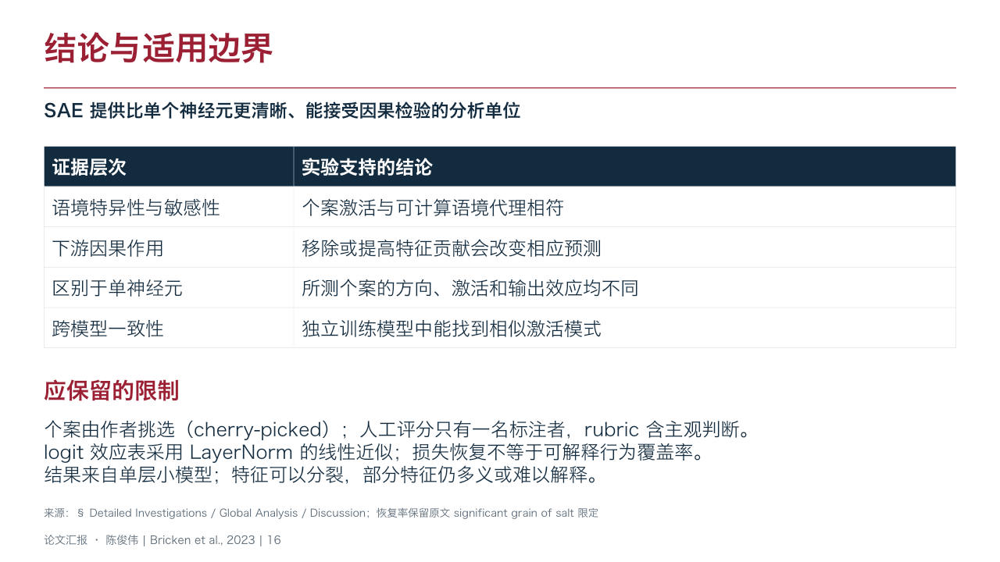

建议用时：60 秒。

这组实验支持四个结论：SAE 能提取激活相对一致的特征；这些特征的写入方向和实际干预具有可解释的输出作用；典型特征的解释性优于神经元；部分特征能够跨随机种子重现，并形成更细的结构。边界同样明确：四个个案经过挑选，人工评估只有一名作者参与，评分与代理都有误差，logit 权重采用归一化近似。损失恢复也不等于语义理解比例。这些结果来自单层小模型，不能直接推广到所有大模型。最后两页提供术语索引和完整维度图，便于答疑。

原文定位：

- [feature-analysis](https://transformer-circuits.pub/2023/monosemantic-features/index.html#feature-analysis)
- [global-analysis-interp-caveats](https://transformer-circuits.pub/2023/monosemantic-features/index.html#global-analysis-interp-caveats)
- [global-analysis-how-much](https://transformer-circuits.pub/2023/monosemantic-features/index.html#global-analysis-how-much)
- [discussion](https://transformer-circuits.pub/2023/monosemantic-features/index.html#discussion)

[回到导航](#页面导航)

---

## 17 · 附录：概念与首次出现位置

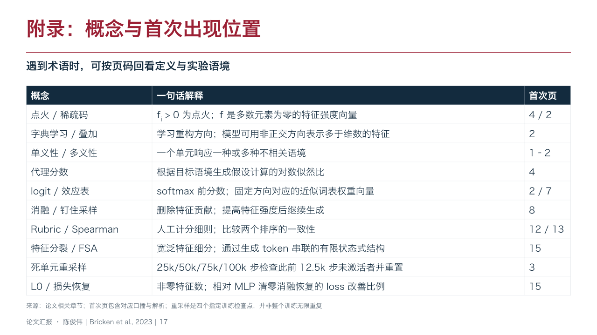

建议用时：40 秒。

这一页把汇报中的术语集中列出，方便回查。请特别区分四组概念：神经元是原模型坐标，特征是学习到的方向及其强度；编码器负责检测，解码器负责写入；logit 是未归一化分数，概率还需要 softmax；激活相关、输出权重相关与损失恢复分别衡量不同对象。表中的首次出现页码对应本次 PPT。死单元重采样属于 SAE 训练步骤，钉住属于训练后的模型干预，两者作用位置和目的也不同。答疑时可以先定位定义，再回到相应实验图。

原文定位：

- [problem-setup-decomposition](https://transformer-circuits.pub/2023/monosemantic-features/index.html#problem-setup-decomposition)
- [setup-autoencoder](https://transformer-circuits.pub/2023/monosemantic-features/index.html#setup-autoencoder)
- [appendix-proxies](https://transformer-circuits.pub/2023/monosemantic-features/index.html#appendix-proxies)
- [appendix-rubric](https://transformer-circuits.pub/2023/monosemantic-features/index.html#appendix-rubric)
- [phenomenology-fsa](https://transformer-circuits.pub/2023/monosemantic-features/index.html#phenomenology-fsa)

[回到导航](#页面导航)

---

## 18 · 附录：模型主线、SAE 支路与观测点

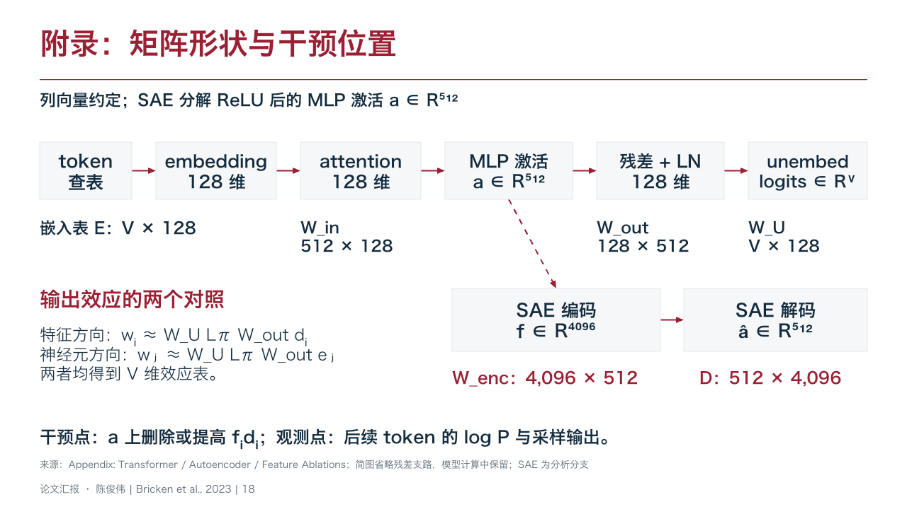

建议用时：50 秒。

最后用完整架构确认所有矩阵的位置。嵌入把 token 变成一百二十八维残差状态；MLP 的上投影得到五百一十二维，再经 ReLU 形成我们分析的激活。SAE 把它编码到四千零九十六维，再解码回五百一十二维。原模型的下投影把激活写回残差流，经过归一化和反嵌入得到词表 logits。删除与钉住就在 MLP 激活处进行，非神经元检验比较同一位置的原坐标与 SAE 特征，输出效应则在词表端观察。注意 SAE 是分析支路，原模型日常预测并不必须经过它。

原文定位：

- [setup-transformer](https://transformer-circuits.pub/2023/monosemantic-features/index.html#setup-transformer)
- [problem-setup-decomposition](https://transformer-circuits.pub/2023/monosemantic-features/index.html#problem-setup-decomposition)
- [feature-arabic-effect](https://transformer-circuits.pub/2023/monosemantic-features/index.html#feature-arabic-effect)
- [appendix-transformer](https://transformer-circuits.pub/2023/monosemantic-features/index.html#appendix-transformer)

[回到导航](#页面导航)

---

## 图片与许可

预览页中的论文原图归原权利人所有，原创中文讲解与配置采用 MIT。详见 [第三方材料说明](../THIRD_PARTY_NOTICES.md)。

本页由 `scripts/build_docs.py` 从 `data/slides.json` 生成。
